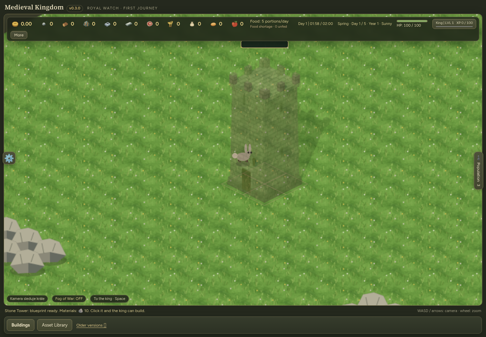
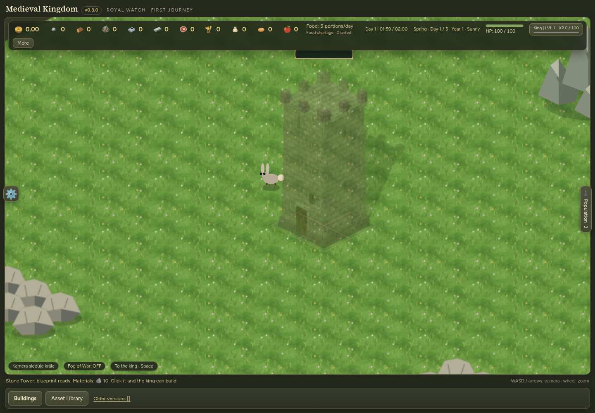

# AUD66 / Issue95 — wildlife building clearance

Audit base: main `0b6b163` (C05 already merged). No C04/C05 input, worker,
player, unit panel, renderer, UI or Studio source is changed by this task.

## Reproduced problem

Previously AnimalSystem picked a random walkable destination and routed on the
ordinary terrain map. Only the building's own footprint was blocked. With a
2×2 tower at (50,50), a rabbit at (48,50), and native wander random values
`[0.6, 0.5, 0.5]`, one 1000 ms update moved the rabbit to (49,50), directly beside
the tower. Collision avoidance alone was not building clearance.

The browser audit repeats that native wandering scenario around a real paid
physical tower blueprint at (12,12). Before (built C05 source), the rabbit moves
from (10,12) to (11,12). After, it remains at (10,12). Both leave ordinary ground
at (11,12) walkable and do not reveal fog. The screenshots use actual game
rendering, not replacement art; surrounding wildlife/resource positions can vary
between builds. The tower footprint and audited rabbit coordinates are the same.

| Before — rabbit enters the immediate ring | After — rabbit stays outside it |
|---|---|
|  |  |

## Rule and integration

The rule is one tile in the eight directions around non-walkable buildings and
physical construction sites. Walkable fields/paths and provisional blueprints
that claim no physical ground do not exclude animals. The original request had
no numeric radius; one immediate ring is the smallest consistent clearance,
using the same diagonal geometry as navigation rather than a large new radius.

It applies to the existing huntable wildlife (rabbit, deer, wild boar) during
ordinary wandering and spawning. The existing interactive horse has no separate
persisted wild/owned flag; its mounting, dismounting and movement stay unchanged.
Combat retaliation also retains the existing path, so hunting is still possible
beside structures. Workers and the king use the original map.

`WildlifeClearance` derives a footprint mask, rebuilding it only when structures
change. Routes reuse the existing pathfinder. New structures invalidate a
wander path; an already reserved half-step is completed without teleporting. An
animal within a newly created margin takes a real-map route to the first safe
tile and can wander again. A narrow gap may be unsuitable for wandering, but
animals can route around it; the ordinary passage remains open to humans. A
failed escape follows the normal bounded wander retry interval.

No persistent state is added, so SAVE_VERSION stays 21. An in-flight current
schema save round-trips exactly; the derived mask rebuilds after Load.

## Verification

- `tests/wildlife-clearance.test.js`: immediate/diagonal clearance, entire route
  through a narrow-gap scenario, new structure during movement, escape, hunting
  retaliation, mounting/dismounting, initial counts and respawn, unchanged fog,
  exact current Save/Load and 200 animals reusing the mask, plus a cramped map with no safe wildlife
  positions that must still spawn its interactive horse.
- `scripts/wildlife-clearance-smoke.mjs`: real game placement and native wander,
  open ordinary terrain, unchanged exploration and world restoration. Included
  in `--full`, or run with `--current-only --wildlife-clearance`.
- Local gate: 570 tests passed; changelog validation, build:pages and the relevant
  browser smoke passed. PR/CI/merge/deployment evidence is recorded in Issue95.

The before image is from the existing C05 build; the after image is from this
branch. No historical archive or production graphic was modified.
